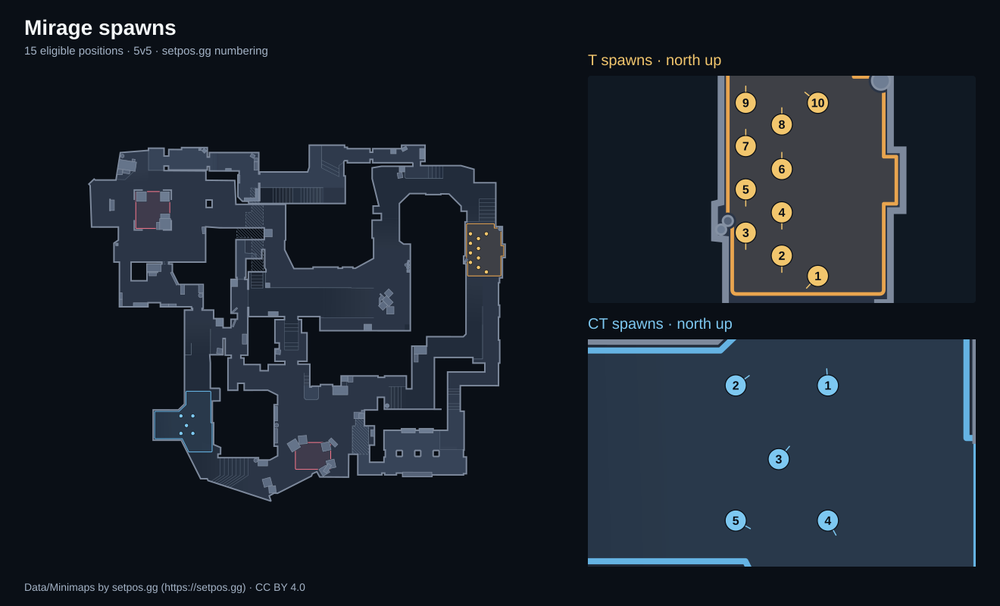
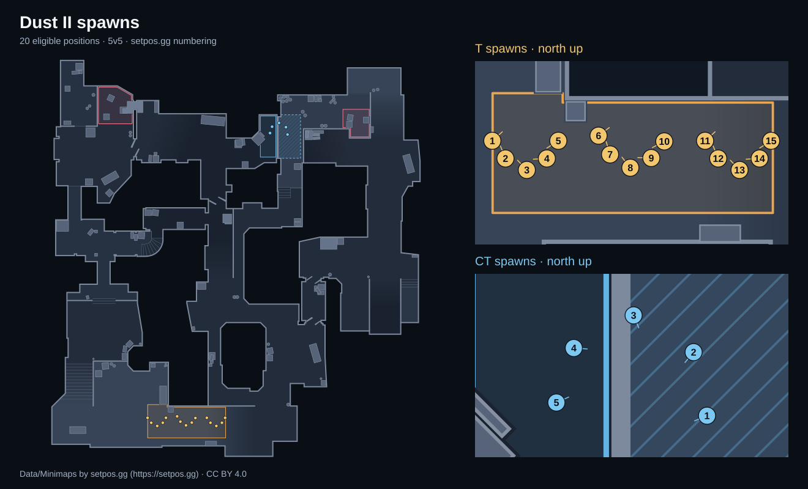
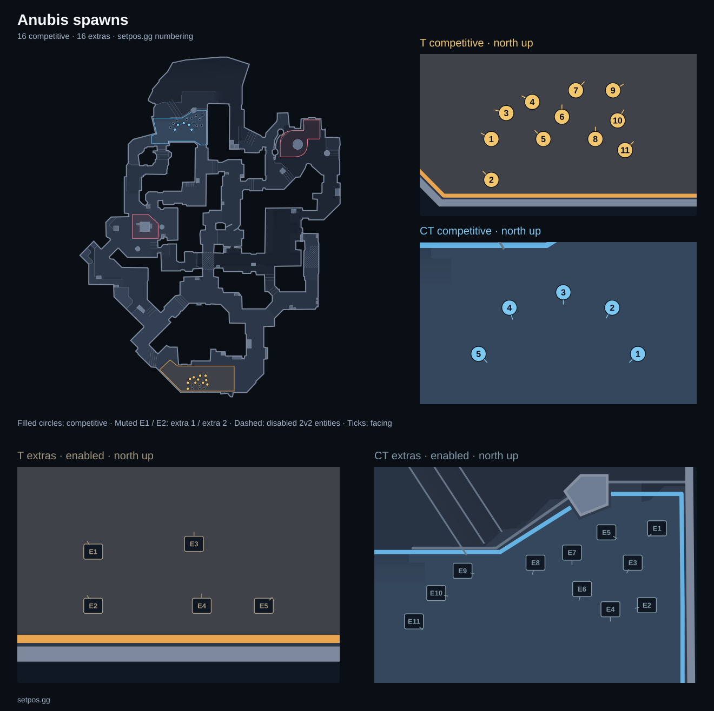
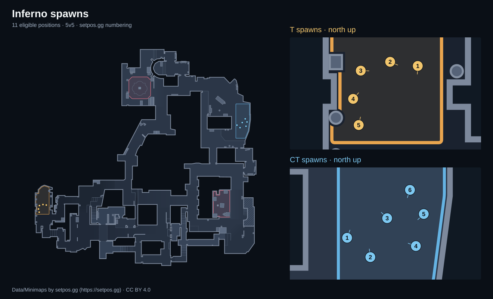
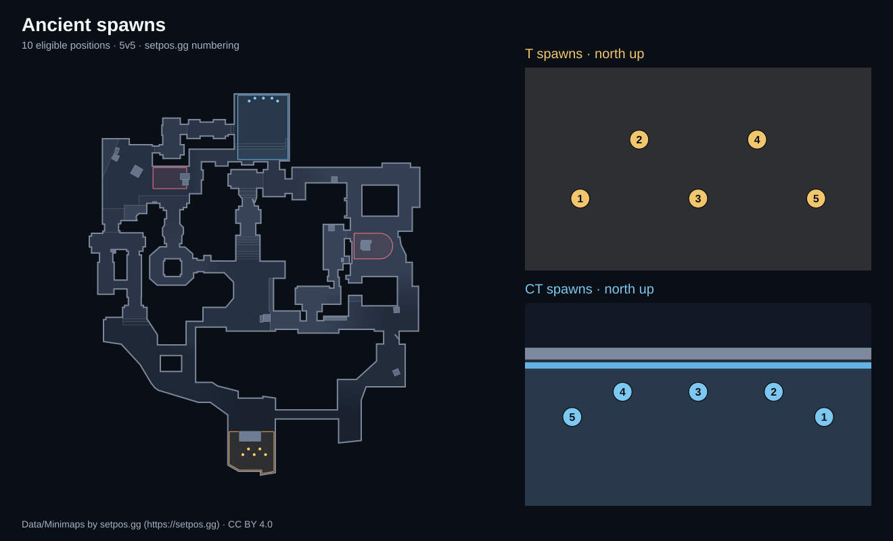
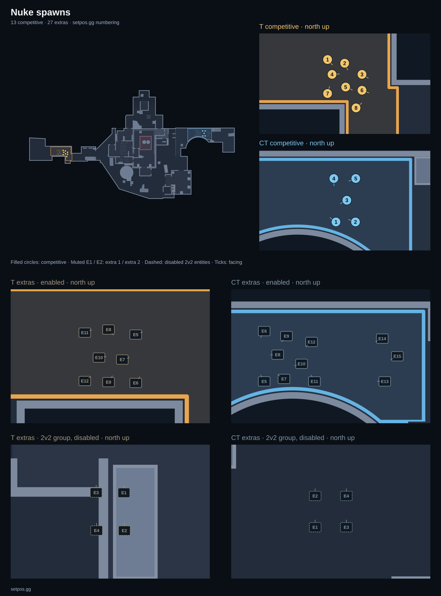
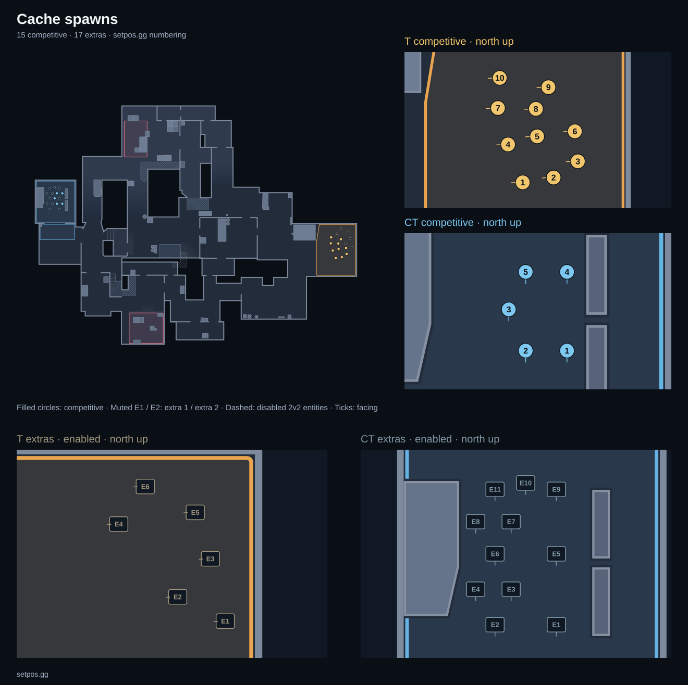

# CS2 spawns

Current competitive spawn positions for seven Counter-Strike 2 maps, with numbered diagrams,
console commands, JSON and CSV. These are the slots [setpos.gg](https://setpos.gg) uses for
instant-spawn grenade lineups. A side can have more than five eligible slots; this is not a list
of casual or deathmatch spawns.

<!-- generated:coverage -->
100 current competitive positions across 7 maps. 100 have angles checked against full map-entity angles (Steam build 25947352, 2026-10-15). 94 feet heights come from the spawn registries; 6 come from published lineup commands. 0 use an unsettled entity height (marked † if present). See [angle-evidence.json](angle-evidence.json) for measured origins, full angles, map hashes and the supplemental feet-height sources.
<!-- /generated:coverage -->

## Use in game

Load the matching map on a local practice server, enable the developer console, and run:

```text
sv_cheats 1
```

Copy a command from a table below. `setpos` moves your player's feet; it does not take eye
height. `setpos …; setang …` also sets the map-authored facing. Angles are degrees in pitch,
yaw, roll order. These commands need a server where you can enable cheats.

The recorded entity pitch and roll are zero on every included map. Yaw comes from each spawn
entity, rounded to the same value used by the site. This was checked against the installed map
files, not against the first player eye-angle tick in a demo. It is a spawn facing, not a grenade
lineup's aim. The site's spawn link shows the lineups available from that position.

Six Cache T feet heights missing from the registry were checked against full-precision
published lineup commands on setpos.gg. Their `zStatus` is `published-lineup-feet`, with the
source page and command in the evidence file. Other positions use feet heights observed in
competitive demos. Map updates can change eligibility or geometry.

If a future position is missing a feet measurement, `zStatus: entity-origin-unsettled` and †
will flag it. That command uses the map's entity height; let the player land before throwing.
No ground height is guessed.

For a menu that teleports you to spawns and shows the lineups in game, use the
[setpos.gg Workshop practice maps](https://setpos.gg/workshop).

## Numbering

Numbers follow the site's convention, not an order supplied by Valve. Face the team's general
exit direction: count left to right when the spawn area is wider than it is deep, and front to
back when it is deeper. Ties go front first when counting across, left first when counting back.
Each side starts at 1. The direction is the cardinal radar heading nearest the middle of that
team's spawn facings; ambiguous cases have an explicit heading in the source registry.

The diagrams are north-up. Numbered circles link to the spawn's page. Some spawn links return
404 until a lineup is published for that slot; the map links remain available. Page links use
the site's numbering; older practice-map builds can have different numbers.

## Files and schema

- [spawns.json](spawns.json): `{ "schemaVersion": 1, "spawns": [...] }`.
- `csv/<map>.csv`: the same records, with a header; JSON nulls are empty CSV fields.
- `maps/<map>.svg`: our vector minimap, an overview, and enlarged numbered T/CT views.
- [angle-evidence.json](angle-evidence.json): measured entity origins and full angles, map archive
  SHA-256 hashes, Steam build and measurement date. This contains measurements, not game files.

Each spawn record has these fields:

| Field | Meaning |
| --- | --- |
| `map` | Site slug: `ancient`, `anubis`, `cache`, `dust2`, `inferno`, `mirage`, `nuke`. |
| `side` | `t` or `ct`. |
| `label` | The site's number, for example `T spawn 10`. |
| `x`, `y`, `z` | World units, at the player's feet unless `zStatus` says otherwise. |
| `zStatus` | `observed-feet` (registry), `published-lineup-feet` (supplemental measurement), or `entity-origin-unsettled` (see † above). |
| `pitch`, `yaw` | Degrees, or `null` when the slot's entity angles have not been verified. |
| `angleStatus` | `map-entity` means checked against a matching entity; `unverified` means no supported angles. Neither claims a runtime eye-angle test. |
| `setpos` | Position command, formatted to six decimal places like the product. |
| `setposSetang` | Position plus supported pitch/yaw/roll, or `null` if angles are unverified. |
| `url` | The spawn's address on setpos.gg. Availability depends on published lineups. |

The dataset follows the current spawn registry used by setpos.gg. Cache uses its current build
registry rather than the older demo-only positions. Positions for the other maps come from
observed 5v5 demo spawns, matched against the installed entities. Files and the tables below are
generated from the main setpos repository; corrections belong there so the site and this copy
stay in sync. README prose and the licence live here.

## Maps and commands

<!-- generated:maps -->
### Mirage

[Mirage on setpos.gg](https://setpos.gg/mirage) · [CSV](csv/mirage.csv)



| Spawn | setpos | setpos + setang | Page |
| --- | --- | --- | --- |
| T spawn 1 | `setpos 1296.000000 -352.000000 -167.968750` | `setpos 1296.000000 -352.000000 -167.968750; setang 0.000000 227.000000 0.000000` | [Open](https://setpos.gg/mirage/t1) |
| T spawn 2 | `setpos 1216.000000 -307.000000 -164.814819` | `setpos 1216.000000 -307.000000 -164.814819; setang 0.000000 270.000000 0.000000` | [Open](https://setpos.gg/mirage/t2) |
| T spawn 3 | `setpos 1136.000000 -256.000000 -164.836548` | `setpos 1136.000000 -256.000000 -164.836548; setang 0.000000 270.000000 0.000000` | [Open](https://setpos.gg/mirage/t3) |
| T spawn 4 | `setpos 1216.000000 -211.000000 -163.968750` | `setpos 1216.000000 -211.000000 -163.968750; setang 0.000000 270.000000 0.000000` | [Open](https://setpos.gg/mirage/t4) |
| T spawn 5 | `setpos 1136.000000 -160.000000 -164.430542` | `setpos 1136.000000 -160.000000 -164.430542; setang 0.000000 270.000000 0.000000` | [Open](https://setpos.gg/mirage/t5) |
| T spawn 6 | `setpos 1216.000000 -115.000000 -163.968750` | `setpos 1216.000000 -115.000000 -163.968750; setang 0.000000 90.000000 0.000000` | [Open](https://setpos.gg/mirage/t6) |
| T spawn 7 | `setpos 1136.000000 -64.000000 -164.499146` | `setpos 1136.000000 -64.000000 -164.499146; setang 0.000000 90.000000 0.000000` | [Open](https://setpos.gg/mirage/t7) |
| T spawn 8 | `setpos 1216.000000 -16.000000 -163.968750` | `setpos 1216.000000 -16.000000 -163.968750; setang 0.000000 90.000000 0.000000` | [Open](https://setpos.gg/mirage/t8) |
| T spawn 9 | `setpos 1136.000000 32.000000 -164.788452` | `setpos 1136.000000 32.000000 -164.788452; setang 0.000000 90.000000 0.000000` | [Open](https://setpos.gg/mirage/t9) |
| T spawn 10 | `setpos 1296.000000 32.000000 -167.968750` | `setpos 1296.000000 32.000000 -167.968750; setang 0.000000 141.000000 0.000000` | [Open](https://setpos.gg/mirage/t10) |
| CT spawn 1 | `setpos -1656.000000 -1800.000000 -267.206421` | `setpos -1656.000000 -1800.000000 -267.206421; setang 0.000000 94.000000 0.000000` | [Open](https://setpos.gg/mirage/ct1) |
| CT spawn 2 | `setpos -1776.000000 -1800.000000 -263.968750` | `setpos -1776.000000 -1800.000000 -263.968750; setang 0.000000 36.000000 0.000000` | [Open](https://setpos.gg/mirage/ct2) |
| CT spawn 3 | `setpos -1720.000000 -1896.000000 -267.602295` | `setpos -1720.000000 -1896.000000 -267.602295; setang 0.000000 50.000000 0.000000` | [Open](https://setpos.gg/mirage/ct3) |
| CT spawn 4 | `setpos -1656.000000 -1976.000000 -267.458313` | `setpos -1656.000000 -1976.000000 -267.458313; setang 0.000000 299.000000 0.000000` | [Open](https://setpos.gg/mirage/ct4) |
| CT spawn 5 | `setpos -1776.000000 -1976.000000 -263.968750` | `setpos -1776.000000 -1976.000000 -263.968750; setang 0.000000 331.000000 0.000000` | [Open](https://setpos.gg/mirage/ct5) |

### Dust II

[Dust II on setpos.gg](https://setpos.gg/dust2) · [CSV](csv/dust2.csv)



| Spawn | setpos | setpos + setang | Page |
| --- | --- | --- | --- |
| T spawn 1 | `setpos -1181.000000 -754.000000 120.181252` | `setpos -1181.000000 -754.000000 120.181252; setang 0.000000 42.000000 0.000000` | [Open](https://setpos.gg/dust2/t1) |
| T spawn 2 | `setpos -1141.000000 -808.000000 116.685989` | `setpos -1141.000000 -808.000000 116.685989; setang 0.000000 112.000000 0.000000` | [Open](https://setpos.gg/dust2/t2) |
| T spawn 3 | `setpos -1076.000000 -843.000000 116.789474` | `setpos -1076.000000 -843.000000 116.789474; setang 0.000000 133.500000 0.000000` | [Open](https://setpos.gg/dust2/t3) |
| T spawn 4 | `setpos -1015.000000 -808.000000 116.082619` | `setpos -1015.000000 -808.000000 116.082619; setang 0.000000 183.000000 0.000000` | [Open](https://setpos.gg/dust2/t4) |
| T spawn 5 | `setpos -980.000000 -754.000000 120.181267` | `setpos -980.000000 -754.000000 120.181267; setang 0.000000 212.500000 0.000000` | [Open](https://setpos.gg/dust2/t5) |
| T spawn 6 | `setpos -857.506531 -738.361328 122.089119` | `setpos -857.506531 -738.361328 122.089119; setang 0.000000 37.000000 0.000000` | [Open](https://setpos.gg/dust2/t6) |
| T spawn 7 | `setpos -822.365173 -795.642090 117.264000` | `setpos -822.365173 -795.642090 117.264000; setang 0.000000 107.000000 0.000000` | [Open](https://setpos.gg/dust2/t7) |
| T spawn 8 | `setpos -760.662964 -836.174011 117.071777` | `setpos -760.662964 -836.174011 117.071777; setang 0.000000 128.500000 0.000000` | [Open](https://setpos.gg/dust2/t8) |
| T spawn 9 | `setpos -696.844604 -806.623718 116.708214` | `setpos -696.844604 -806.623718 116.708214; setang 0.000000 178.000000 0.000000` | [Open](https://setpos.gg/dust2/t9) |
| T spawn 10 | `setpos -657.271362 -755.879639 119.884018` | `setpos -657.271362 -755.879639 119.884018; setang 0.000000 207.500000 0.000000` | [Open](https://setpos.gg/dust2/t10) |
| T spawn 11 | `setpos -533.000000 -754.000000 113.848991` | `setpos -533.000000 -754.000000 113.848991; setang 0.000000 42.000000 0.000000` | [Open](https://setpos.gg/dust2/t11) |
| T spawn 12 | `setpos -493.000000 -808.000000 108.563377` | `setpos -493.000000 -808.000000 108.563377; setang 0.000000 112.000000 0.000000` | [Open](https://setpos.gg/dust2/t12) |
| T spawn 13 | `setpos -428.000000 -843.000000 95.296280` | `setpos -428.000000 -843.000000 95.296280; setang 0.000000 133.500000 0.000000` | [Open](https://setpos.gg/dust2/t13) |
| T spawn 14 | `setpos -367.000000 -808.000000 83.744965` | `setpos -367.000000 -808.000000 83.744965; setang 0.000000 183.000000 0.000000` | [Open](https://setpos.gg/dust2/t14) |
| T spawn 15 | `setpos -332.000000 -754.000000 78.877106` | `setpos -332.000000 -754.000000 78.877106; setang 0.000000 212.500000 0.000000` | [Open](https://setpos.gg/dust2/t15) |
| CT spawn 1 | `setpos 351.392120 2352.942383 -120.474915` | `setpos 351.392120 2352.942383 -120.474915; setang 0.000000 202.500000 0.000000` | [Open](https://setpos.gg/dust2/ct1) |
| CT spawn 2 | `setpos 334.368744 2433.733643 -120.362549` | `setpos 334.368744 2433.733643 -120.362549; setang 0.000000 230.000000 0.000000` | [Open](https://setpos.gg/dust2/ct2) |
| CT spawn 3 | `setpos 258.159393 2480.553711 -121.076660` | `setpos 258.159393 2480.553711 -121.076660; setang 0.000000 292.500000 0.000000` | [Open](https://setpos.gg/dust2/ct3) |
| CT spawn 4 | `setpos 182.249908 2439.011719 -120.968750` | `setpos 182.249908 2439.011719 -120.968750; setang 0.000000 356.000000 0.000000` | [Open](https://setpos.gg/dust2/ct4) |
| CT spawn 5 | `setpos 160.122742 2369.676270 -119.918701` | `setpos 160.122742 2369.676270 -119.918701; setang 0.000000 24.000000 0.000000` | [Open](https://setpos.gg/dust2/ct5) |

### Anubis

[Anubis on setpos.gg](https://setpos.gg/anubis) · [CSV](csv/anubis.csv)



| Spawn | setpos | setpos + setang | Page |
| --- | --- | --- | --- |
| T spawn 1 | `setpos -416.000000 -1608.000000 2.031250` | `setpos -416.000000 -1608.000000 2.031250; setang 0.000000 150.000000 0.000000` | [Open](https://setpos.gg/anubis/t1) |
| T spawn 2 | `setpos -416.000000 -1696.000000 2.031250` | `setpos -416.000000 -1696.000000 2.031250; setang 0.000000 135.000000 0.000000` | [Open](https://setpos.gg/anubis/t2) |
| T spawn 3 | `setpos -384.000000 -1552.000000 -11.968750` | `setpos -384.000000 -1552.000000 -11.968750; setang 0.000000 165.000000 0.000000` | [Open](https://setpos.gg/anubis/t3) |
| T spawn 4 | `setpos -328.000000 -1528.000000 -11.968750` | `setpos -328.000000 -1528.000000 -11.968750; setang 0.000000 150.000000 0.000000` | [Open](https://setpos.gg/anubis/t4) |
| T spawn 5 | `setpos -304.000000 -1608.000000 -11.968750` | `setpos -304.000000 -1608.000000 -11.968750; setang 0.000000 135.000000 0.000000` | [Open](https://setpos.gg/anubis/t5) |
| T spawn 6 | `setpos -264.000000 -1560.000000 -11.968750` | `setpos -264.000000 -1560.000000 -11.968750; setang 0.000000 90.000000 0.000000` | [Open](https://setpos.gg/anubis/t6) |
| T spawn 7 | `setpos -234.000000 -1503.079956 -11.968750` | `setpos -234.000000 -1503.079956 -11.968750; setang 0.000000 45.000000 0.000000` | [Open](https://setpos.gg/anubis/t7) |
| T spawn 8 | `setpos -192.000000 -1608.000000 -11.968750` | `setpos -192.000000 -1608.000000 -11.968750; setang 0.000000 90.000000 0.000000` | [Open](https://setpos.gg/anubis/t8) |
| T spawn 9 | `setpos -154.000000 -1503.079956 -11.968750` | `setpos -154.000000 -1503.079956 -11.968750; setang 0.000000 30.000000 0.000000` | [Open](https://setpos.gg/anubis/t9) |
| T spawn 10 | `setpos -144.000000 -1568.000000 -11.968750` | `setpos -144.000000 -1568.000000 -11.968750; setang 0.000000 60.000000 0.000000` | [Open](https://setpos.gg/anubis/t10) |
| T spawn 11 | `setpos -128.004028 -1632.000000 -0.960938` | `setpos -128.004028 -1632.000000 -0.960938; setang 0.000000 45.000000 0.000000` | [Open](https://setpos.gg/anubis/t11) |
| CT spawn 1 | `setpos -360.000000 2120.000000 16.056593` | `setpos -360.000000 2120.000000 16.056593; setang 0.000000 225.000000 0.000000` | [Open](https://setpos.gg/anubis/ct1) |
| CT spawn 2 | `setpos -400.000000 2192.000000 25.031252` | `setpos -400.000000 2192.000000 25.031252; setang 0.000000 240.000000 0.000000` | [Open](https://setpos.gg/anubis/ct2) |
| CT spawn 3 | `setpos -476.000000 2216.000000 25.031252` | `setpos -476.000000 2216.000000 25.031252; setang 0.000000 270.000000 0.000000` | [Open](https://setpos.gg/anubis/ct3) |
| CT spawn 4 | `setpos -560.000000 2192.000000 25.031252` | `setpos -560.000000 2192.000000 25.031252; setang 0.000000 285.000000 0.000000` | [Open](https://setpos.gg/anubis/ct4) |
| CT spawn 5 | `setpos -608.000000 2120.000000 16.056595` | `setpos -608.000000 2120.000000 16.056595; setang 0.000000 315.000000 0.000000` | [Open](https://setpos.gg/anubis/ct5) |

### Inferno

[Inferno on setpos.gg](https://setpos.gg/inferno) · [CSV](csv/inferno.csv)



| Spawn | setpos | setpos + setang | Page |
| --- | --- | --- | --- |
| T spawn 1 | `setpos -1520.060059 430.890991 -63.968750` | `setpos -1520.060059 430.890991 -63.968750; setang 0.000000 267.000000 0.000000` | [Open](https://setpos.gg/inferno/t1) |
| T spawn 2 | `setpos -1586.520020 440.790009 -63.968750` | `setpos -1586.520020 440.790009 -63.968750; setang 0.000000 337.000000 0.000000` | [Open](https://setpos.gg/inferno/t2) |
| T spawn 3 | `setpos -1657.229980 419.576996 -63.968750` | `setpos -1657.229980 419.576996 -63.968750; setang 0.000000 358.500000 0.000000` | [Open](https://setpos.gg/inferno/t3) |
| T spawn 4 | `setpos -1675.619995 351.695007 -63.968750` | `setpos -1675.619995 351.695007 -63.968750; setang 0.000000 48.000000 0.000000` | [Open](https://setpos.gg/inferno/t4) |
| T spawn 5 | `setpos -1662.180054 288.761993 -63.968750` | `setpos -1662.180054 288.761993 -63.968750; setang 0.000000 77.500000 0.000000` | [Open](https://setpos.gg/inferno/t5) |
| CT spawn 1 | `setpos 2292.060059 2027.689941 135.956955` | `setpos 2292.060059 2027.689941 135.956955; setang 0.000000 70.000000 0.000000` | [Open](https://setpos.gg/inferno/ct1) |
| CT spawn 2 | `setpos 2353.000000 1977.000000 135.518875` | `setpos 2353.000000 1977.000000 135.518875; setang 0.000000 97.500000 0.000000` | [Open](https://setpos.gg/inferno/ct2) |
| CT spawn 3 | `setpos 2397.000000 2079.000000 132.767548` | `setpos 2397.000000 2079.000000 132.767548; setang 0.000000 135.000000 0.000000` | [Open](https://setpos.gg/inferno/ct3) |
| CT spawn 4 | `setpos 2472.349854 2005.969971 134.505051` | `setpos 2472.349854 2005.969971 134.505051; setang 0.000000 160.000000 0.000000` | [Open](https://setpos.gg/inferno/ct4) |
| CT spawn 5 | `setpos 2493.000000 2090.000000 132.551376` | `setpos 2493.000000 2090.000000 132.551376; setang 0.000000 223.500000 0.000000` | [Open](https://setpos.gg/inferno/ct5) |
| CT spawn 6 | `setpos 2456.830078 2153.159912 132.077179` | `setpos 2456.830078 2153.159912 132.077179; setang 0.000000 251.500000 0.000000` | [Open](https://setpos.gg/inferno/ct6) |

### Ancient

[Ancient on setpos.gg](https://setpos.gg/ancient) · [CSV](csv/ancient.csv)



| Spawn | setpos | setpos + setang | Page |
| --- | --- | --- | --- |
| T spawn 1 | `setpos -584.000000 -2288.000000 -162.422363` | `setpos -584.000000 -2288.000000 -162.422363; setang 0.000000 90.000000 0.000000` | [Open](https://setpos.gg/ancient/t1) |
| T spawn 2 | `setpos -520.000000 -2224.000000 -163.255737` | `setpos -520.000000 -2224.000000 -163.255737; setang 0.000000 90.000000 0.000000` | [Open](https://setpos.gg/ancient/t2) |
| T spawn 3 | `setpos -456.000000 -2288.000000 -163.255737` | `setpos -456.000000 -2288.000000 -163.255737; setang 0.000000 90.000000 0.000000` | [Open](https://setpos.gg/ancient/t3) |
| T spawn 4 | `setpos -392.000000 -2224.000000 -163.255737` | `setpos -392.000000 -2224.000000 -163.255737; setang 0.000000 90.000000 0.000000` | [Open](https://setpos.gg/ancient/t4) |
| T spawn 5 | `setpos -328.000000 -2288.000000 -163.255737` | `setpos -328.000000 -2288.000000 -163.255737; setang 0.000000 90.000000 0.000000` | [Open](https://setpos.gg/ancient/t5) |
| CT spawn 1 | `setpos -192.000000 1696.000000 26.053045` | `setpos -192.000000 1696.000000 26.053045; setang 0.000000 270.000000 0.000000` | [Open](https://setpos.gg/ancient/ct1) |
| CT spawn 2 | `setpos -256.000000 1728.000000 25.602571` | `setpos -256.000000 1728.000000 25.602571; setang 0.000000 270.000000 0.000000` | [Open](https://setpos.gg/ancient/ct2) |
| CT spawn 3 | `setpos -352.000000 1728.000000 28.813293` | `setpos -352.000000 1728.000000 28.813293; setang 0.000000 270.000000 0.000000` | [Open](https://setpos.gg/ancient/ct3) |
| CT spawn 4 | `setpos -448.000000 1728.000000 30.739708` | `setpos -448.000000 1728.000000 30.739708; setang 0.000000 270.000000 0.000000` | [Open](https://setpos.gg/ancient/ct4) |
| CT spawn 5 | `setpos -512.000000 1696.000000 26.837196` | `setpos -512.000000 1696.000000 26.837196; setang 0.000000 270.000000 0.000000` | [Open](https://setpos.gg/ancient/ct5) |

### Nuke

[Nuke on setpos.gg](https://setpos.gg/nuke) · [CSV](csv/nuke.csv)



| Spawn | setpos | setpos + setang | Page |
| --- | --- | --- | --- |
| T spawn 1 | `setpos -1947.010010 -965.109985 -415.968750` | `setpos -1947.010010 -965.109985 -415.968750; setang 0.000000 312.000000 0.000000` | [Open](https://setpos.gg/nuke/t1) |
| T spawn 2 | `setpos -1878.000000 -980.000000 -415.968750` | `setpos -1878.000000 -980.000000 -415.968750; setang 0.000000 294.000000 0.000000` | [Open](https://setpos.gg/nuke/t2) |
| T spawn 3 | `setpos -1808.000000 -1025.000000 -415.968750` | `setpos -1808.000000 -1025.000000 -415.968750; setang 0.000000 329.000000 0.000000` | [Open](https://setpos.gg/nuke/t3) |
| T spawn 4 | `setpos -1929.000000 -1025.000000 -415.968750` | `setpos -1929.000000 -1025.000000 -415.968750; setang 0.000000 3.000000 0.000000` | [Open](https://setpos.gg/nuke/t4) |
| T spawn 5 | `setpos -1874.000000 -1076.000000 -415.968750` | `setpos -1874.000000 -1076.000000 -415.968750; setang 0.000000 336.000000 0.000000` | [Open](https://setpos.gg/nuke/t5) |
| T spawn 6 | `setpos -1808.000000 -1089.000000 -415.968750` | `setpos -1808.000000 -1089.000000 -415.968750; setang 0.000000 340.000000 0.000000` | [Open](https://setpos.gg/nuke/t6) |
| T spawn 7 | `setpos -1947.010010 -1102.109985 -415.968750` | `setpos -1947.010010 -1102.109985 -415.968750; setang 0.000000 74.500000 0.000000` | [Open](https://setpos.gg/nuke/t7) |
| T spawn 8 | `setpos -1832.000000 -1160.000000 -415.968750` | `setpos -1832.000000 -1160.000000 -415.968750; setang 0.000000 40.000000 0.000000` | [Open](https://setpos.gg/nuke/t8) |
| CT spawn 1 | `setpos 2512.000000 -504.000000 -343.367126` | `setpos 2512.000000 -504.000000 -343.367126; setang 0.000000 145.000000 0.000000` | [Open](https://setpos.gg/nuke/ct1) |
| CT spawn 2 | `setpos 2584.000000 -504.000000 -351.968750` | `setpos 2584.000000 -504.000000 -351.968750; setang 0.000000 161.000000 0.000000` | [Open](https://setpos.gg/nuke/ct2) |
| CT spawn 3 | `setpos 2552.000000 -424.000000 -351.968750` | `setpos 2552.000000 -424.000000 -351.968750; setang 0.000000 207.500000 0.000000` | [Open](https://setpos.gg/nuke/ct3) |
| CT spawn 4 | `setpos 2504.000000 -344.000000 -351.968750` | `setpos 2504.000000 -344.000000 -351.968750; setang 0.000000 271.000000 0.000000` | [Open](https://setpos.gg/nuke/ct4) |
| CT spawn 5 | `setpos 2585.000000 -344.000000 -351.968750` | `setpos 2585.000000 -344.000000 -351.968750; setang 0.000000 200.500000 0.000000` | [Open](https://setpos.gg/nuke/ct5) |

### Cache

[Cache on setpos.gg](https://setpos.gg/cache) · [CSV](csv/cache.csv)



| Spawn | setpos | setpos + setang | Page |
| --- | --- | --- | --- |
| T spawn 1 | `setpos 2995.893555 -168.000000 1608.031372` | `setpos 2995.893555 -168.000000 1608.031372; setang 0.000000 182.000000 0.000000` | [Open](https://setpos.gg/cache/t1) |
| T spawn 2 | `setpos 3094.268555 -152.582214 1608.031494` | `setpos 3094.268555 -152.582214 1608.031494; setang 0.000000 182.000000 0.000000` | [Open](https://setpos.gg/cache/t2) |
| T spawn 3 | `setpos 3171.643555 -100.832214 1608.031250` | `setpos 3171.643555 -100.832214 1608.031250; setang 0.000000 182.000000 0.000000` | [Open](https://setpos.gg/cache/t3) |
| T spawn 4 | `setpos 2949.018555 -47.000008 1608.031372` | `setpos 2949.018555 -47.000008 1608.031372; setang 0.000000 182.000000 0.000000` | [Open](https://setpos.gg/cache/t4) |
| T spawn 5 | `setpos 3041.768555 -21.082214 1608.031372` | `setpos 3041.768555 -21.082214 1608.031372; setang 0.000000 182.000000 0.000000` | [Open](https://setpos.gg/cache/t5) |
| T spawn 6 | `setpos 3162.143555 -5.000008 1608.031372` | `setpos 3162.143555 -5.000008 1608.031372; setang 0.000000 182.000000 0.000000` | [Open](https://setpos.gg/cache/t6) |
| T spawn 7 | `setpos 2916.768555 69.417786 1608.031372` | `setpos 2916.768555 69.417786 1608.031372; setang 0.000000 182.000000 0.000000` | [Open](https://setpos.gg/cache/t7) |
| T spawn 8 | `setpos 3037.893555 66.667786 1608.031372` | `setpos 3037.893555 66.667786 1608.031372; setang 0.000000 182.000000 0.000000` | [Open](https://setpos.gg/cache/t8) |
| T spawn 9 | `setpos 3077.768555 135.917786 1616.031250` | `setpos 3077.768555 135.917786 1616.031250; setang 0.000000 182.000000 0.000000` | [Open](https://setpos.gg/cache/t9) |
| T spawn 10 | `setpos 2922.518555 165.667786 1616.030273` | `setpos 2922.518555 165.667786 1616.030273; setang 0.000000 182.000000 0.000000` | [Open](https://setpos.gg/cache/t10) |
| CT spawn 1 | `setpos -1400.283203 706.819336 1614.031250` | `setpos -1400.283203 706.819336 1614.031250; setang 0.000000 270.000000 0.000000` | [Open](https://setpos.gg/cache/ct1) |
| CT spawn 2 | `setpos -1488.283203 706.819336 1614.031250` | `setpos -1488.283203 706.819336 1614.031250; setang 0.000000 270.000000 0.000000` | [Open](https://setpos.gg/cache/ct2) |
| CT spawn 3 | `setpos -1524.283203 794.819336 1614.031250` | `setpos -1524.283203 794.819336 1614.031250; setang 0.000000 270.000000 0.000000` | [Open](https://setpos.gg/cache/ct3) |
| CT spawn 4 | `setpos -1400.283203 874.819336 1614.031250` | `setpos -1400.283203 874.819336 1614.031250; setang 0.000000 270.000000 0.000000` | [Open](https://setpos.gg/cache/ct4) |
| CT spawn 5 | `setpos -1488.283203 874.819336 1614.031250` | `setpos -1488.283203 874.819336 1614.031250; setang 0.000000 270.000000 0.000000` | [Open](https://setpos.gg/cache/ct5) |
<!-- /generated:maps -->

## Licence and credit

[CC BY 4.0](LICENSE). You can use and adapt the data and diagrams, including commercially.
Keep this credit and a link to the licence, and say if you changed them:

```text
Data/Minimaps by setpos.gg (https://setpos.gg)
Licensed under CC BY 4.0 (https://creativecommons.org/licenses/by/4.0/).
```

Counter-Strike 2 is a trademark of Valve Corporation. Not affiliated with Valve.
